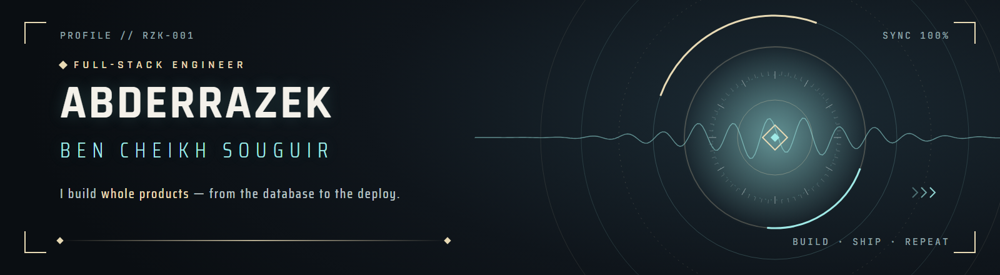
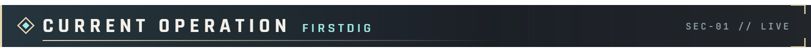
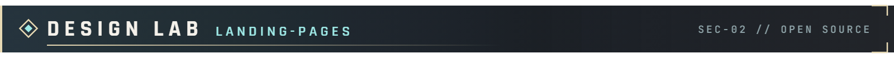
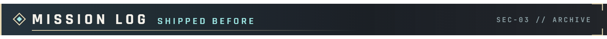
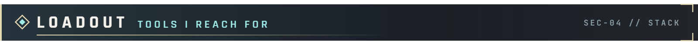
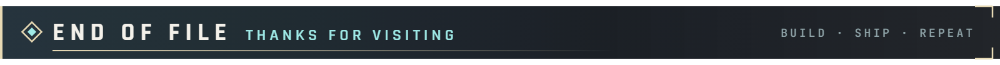

  
  
  

> **PROFILE // RZK-001** — I build complete products on my own: the database, the API and workers, the web and mobile apps, payments, AI and the deploy pipeline. Most of that work lives in private repositories, so this page shows **what it does** rather than the code.

 

  
  
  
  
  

**[FirstDig](https://firstdig.net)** sends US service businesses (pool builders, roofers, solar, HVAC, fence companies…) the new building permits in the areas they draw on a map: every morning, every week, or within the hour.

<table>
<tr>
<td width="50%" valign="top">

**◆ INGESTION**  100 city open-data feeds (Socrata, ArcGIS, CKAN, CSV) normalized into one schema, geocoded, and sorted into 18 trades by rules plus AI. About 110,000 new permits a month.

**◆ DELIVERY**  PostGIS zone matching, idempotent digests, an email outbox with retries, bounce and complaint webhooks.

**◆ PRODUCT**  Job-finished alerts, ready-date estimates (Kaplan–Meier), busiest streets, a door-to-door route planner, AI summaries through the OpenAI Batch API with a monthly budget stop.

</td>
<td width="50%" valign="top">

**◆ AI ASSISTANTS**  An MCP server with OAuth, so customers can ask ChatGPT or Claude about the permits in their area.

**◆ BUSINESS**  Stripe Checkout, Customer Portal and webhooks; plans, limits and modules editable by admins; a 14-day reverse trial.

**◆ OPS**  A stateless API and a separate worker, zero-downtime deploys from GitHub Actions to my own server, and crawler-ready public pages for SEO and AI search.

</td>
</tr>
</table>

  
  
  
  
  
  
  
  
  

 

A growing collection of cinematic landing pages in **[landing-pages](https://github.com/Rezayek/landing-pages)**, each with its own design system, scroll-driven motion and custom visuals. I make them with a **Claude Code design workflow** I'm developing: brief, references, design system, motion, then a critique round by an independent reviewer.

<table>
<tr>
<td width="50%" valign="top">

<b>◆ HALO</b> A titanium training watch that comes apart layer by layer as you scroll, in real-time 3D.
</td>
<td width="50%" valign="top">

<b>◆ PULSE-1</b> A desktop synth you can play on the page, with a live oscilloscope.
</td>
</tr>
</table>

  Also in the lab: <b>VOLTCART</b> (neon game-key store) · <b>Maison Sucre</b> (wedding cakes with a 3D builder) · <b>Kitty</b> (family payments app) · <b>Blockfeed</b> (voxel community) · <b>Echo Atlas</b> (game build hub)  
  

  
  
  
  
  

 

<table>
<tr>
<td width="50%" valign="top">

### ◆ Tourism & hospitality platform
Mobile app, merchant dashboard and backend: bookings, a loyalty and rewards engine, and a **multi-agent AI assistant**. Deployed on AWS.

`FastAPI` `PostgreSQL` `Flutter` `React` `RabbitMQ` `OpenAI Agents SDK` `AWS`

</td>
<td width="50%" valign="top">

### ◆ B2B commodity trading marketplace
**Deal rooms**, live bidding, shipping workflows and contracts, with separate roles for buyers, sellers and admins.

`FastAPI` `PostgreSQL` `React` `TypeScript` `Docker` `AWS`

</td>
</tr>
<tr>
<td width="50%" valign="top">

### ◆ Property management system
Delivered to a paying client: bookings, tenants, finances and reports, built to be **white-labelled** from day one.

`FastAPI` `PostgreSQL` `React` `Docker`

</td>
<td width="50%" valign="top">

### ◆ AI video processing pipeline
Video in, report out: transcoding, **speaker diarization**, translation, agent analysis and PDF reports, all queued and asynchronous.

`Python` `FFmpeg` `CrewAI` `RabbitMQ` `AWS`

</td>
</tr>
<tr>
<td colspan="2" valign="top">

### ◆ [Enigma's Echo](https://github.com/Rezayek/Enigma-s-echo-source-code)
A puzzle-driven mystery adventure game with environmental storytelling, made during an internship.
`Unity` `C#` `Blender`

</td>
</tr>
</table>

 

<table align="center">
<tr>
<td width="25%" valign="top"><b>◆ BACKEND</b>  
 
 
 

</td>
<td width="25%" valign="top"><b>◆ APPS</b>  
 
 
 

</td>
<td width="25%" valign="top"><b>◆ AI</b>  
 
 
 

</td>
<td width="25%" valign="top"><b>◆ INFRA</b>  
 
 
 

</td>
</tr>
</table>

 

  Open to freelance work on full-stack products and AI integrations.  
  
  

 

